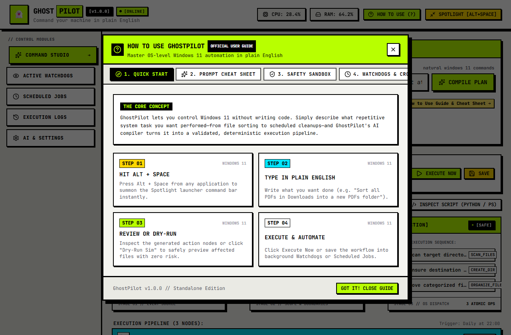
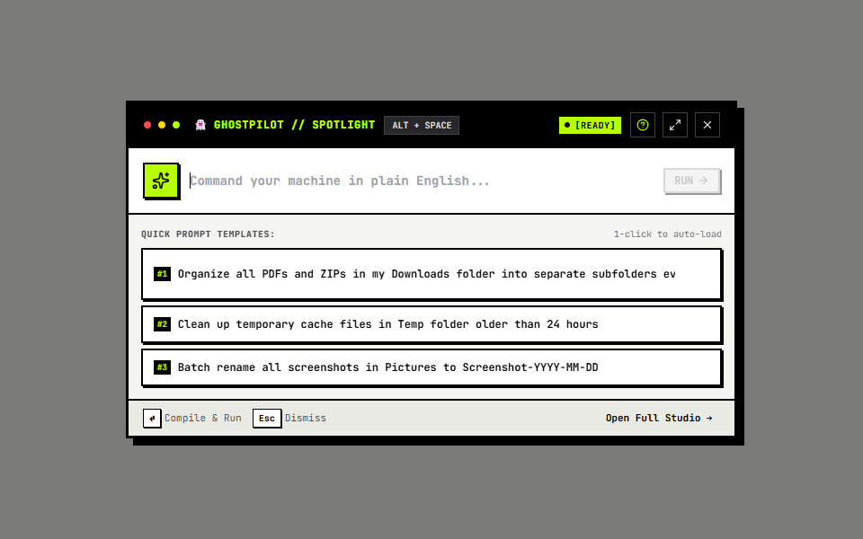
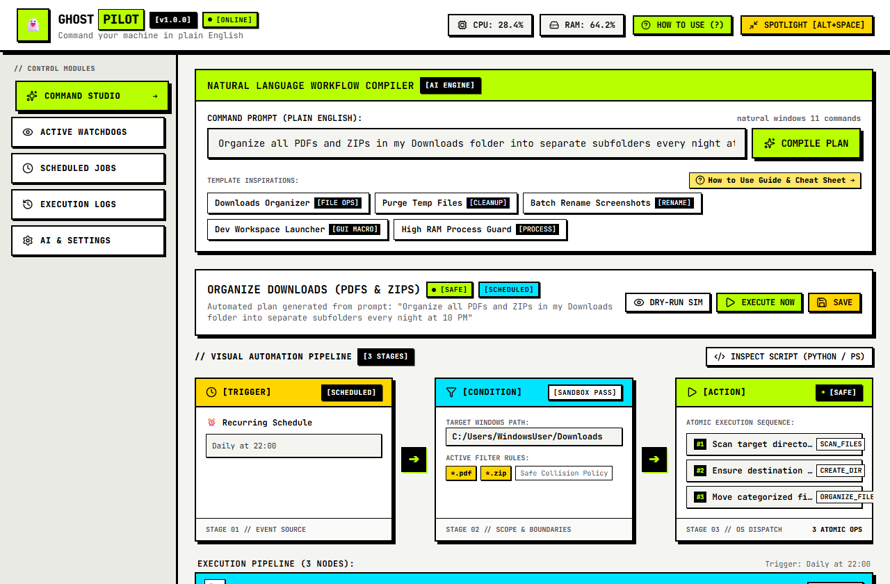
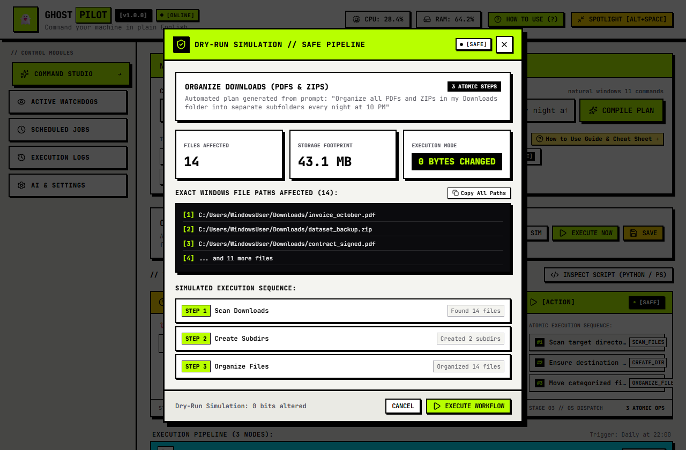

<div align="center">



<br>

[](https://git.io/typing-svg)

<p align="center">
  
  
  
  
  
</p>

<p align="center">
  <b>Hit <kbd>Alt</kbd> + <kbd>Space</kbd> anywhere in Windows 11 to summon the Spotlight command bar.</b>
</p>

---

</div>

## 🚀 Executable (`.exe`) Location & Quick Start

GhostPilot is compiled as a **100% standalone Windows 11 application**. Both core binaries are placed directly in the **project root directory**:

```powershell
./GhostPilot.exe   # [24.6 MB] Native Desktop App & Neo-Brutalist UI
./worker.exe       # [85.1 MB] Standalone Python Automation Engine
```

### ⚡ One-Click Instant Launch
Double-click **`GhostPilot.exe`** in Windows Explorer or run the following command in PowerShell:

```powershell
# From the project root folder:
.\GhostPilot.exe
```

> [!TIP]
> **Zero Prerequisites Needed!** You do not need Python, Node.js, Rust, or npm installed on the target machine. `GhostPilot.exe` connects automatically to the bundled `worker.exe` and runs 100% offline.

---

## 🖥️ System Requirements & Low-End Hardware Specs

GhostPilot is engineered to be **extremely lightweight, battery-friendly, and capable of running smoothly on budget and low-end hardware**. Because the Rust shell and Python sidecar run with native Windows Win32 APIs, resource consumption is kept minimal:

| Hardware / Environment | Budget & Low-End Hardware *(Heuristic Mode)* | Recommended Specs *(Smooth 60 FPS + Local AI)* |
| :--- | :--- | :--- |
| **Operating System** | Windows 10 x64 (Build 19044+ / 21H2) | **Windows 11 (22H2 / 23H2+) x64 Native** |
| **Processor (CPU)** | Intel Celeron / Pentium / Core i3 (4th Gen+) / AMD Athlon (dual-core 1.8 GHz) | **Intel Core i5/i7 (8th Gen+) / AMD Ryzen 5+ (4+ cores)** |
| **System Memory (RAM)**| **2 GB – 4 GB RAM** *(App idle usage: ~45 MB – 65 MB)* | **8 GB – 16 GB RAM** *(16 GB if hosting local 3B+ Ollama LLMs)* |
| **Storage / Disk** | 300 MB free space (HDD or basic SATA SSD) | **1 GB+ free NVMe SSD** *(room for logs, DB, & optional LLM models)* |
| **Display Resolution** | 1280 × 720 (720p HD) or 1366 × 768 laptop screen | **1920 × 1080 (1080p FHD)** or higher *(optimized for 680px Spotlight)* |
| **Graphics (GPU)**     | Integrated Intel HD Graphics 4000+ / AMD Radeon | Dedicated GPU (NVIDIA GTX 1650+ / RTX) *optional for local LLM acceleration* |
| **Runtime Software**   | Microsoft Edge WebView2 *(Pre-installed on Win 10/11)* | Pre-installed Windows WebView2 (zero manual configuration required) |

> [!TIP]
> **🚀 Engineered for Low-End PC Performance:**
> - ⚡ **Native Win32 Kernel Polling:** Memory and CPU metrics query Windows `kernel32.dll` (`GlobalMemoryStatusEx` & `GetSystemTimes`) directly from Rust in **under 0.001ms** without spawning background console processes.
> - ⚡ **Instant Heuristic Engine:** Offline natural language parser compiles complex automations in **< 1ms** with zero neural network RAM overhead.
> - ⚡ **Background Tab Throttling:** Polling automatically pauses whenever GhostPilot is minimized or running behind other windows (`document.hidden`), preserving laptop battery and keeping CPU utilization **< 0.1%**.
> - ⚡ **Silent Execution (`CREATE_NO_WINDOW`):** Worker tasks run completely silent with zero CMD window flashes, zero terminal allocation, and zero UI stutter.

---

## 🎬 Sleek Startup & Interactive Guide

GhostPilot includes a high-speed animated intro and a built-in user guide:

```
┌─────────────────────────────────────────────────────────────┐
│ 👻 GHOSTPILOT // SYSTEM KERNEL BOOT [v1.0.0 x64]            │
├─────────────────────────────────────────────────────────────┤
│  ✔ [BOOT] Initializing Tauri v2 Desktop Engine & WebView2   │
│  ✔ [BRIDGE] Linking Standalone Python 3.14 Automation Engine│
│  ✔ [STORAGE] Mounting SQLite DB (%APPDATA%/GhostPilot)      │
│  ✔ [HOTKEY] Bound Windows Global Spotlight [Alt + Space]    │
│  ✔ [READY] All Subsystems 100% Operational                  │
│                                                             │
│  [=========================================] 100%           │
└─────────────────────────────────────────────────────────────┘
```

- **Sleek Startup Screen**: Animated pulse logo, cyber grid backdrop, progressive diagnostic logs, and animated loading bar (press `Esc` or `Space` to skip).
- **Interactive "How to Use" Popup**: Press **`F1`** or click **`How to Use (?)`** in the header to open a 5-tab walkthrough with 1-click test prompts and copyable cheat sheets.

<div align="center">
  
  <p align="center"><sub><b>Figure 1:</b> Real running UI capture of the built-in 5-tab Interactive Walkthrough & Prompt Cheat Sheet (<kbd>F1</kbd>).</sub></p>
</div>

> [!NOTE]
> **Key Interactive Guide Highlights:**
> - 📑 **5 Curated Walkthrough Tabs**: Switch seamlessly between `Overview`, `File Automation`, `System Cleanup`, `App Workspaces`, and `Shortcuts Reference`.
> - ⚡ **1-Click Prompt Injector**: Clicking any preloaded recipe automatically loads it into the compiler pipeline without manual typing.
> - 📋 **Canonical Path Reference**: Pre-calculated Windows path cheat sheets (`%USERPROFILE%\Downloads`, `%TEMP%`, `%APPDATA%`).
> - ⌨️ **Universal Hotkey Access**: Hit <kbd>F1</kbd> or click the `How to Use (?)` button anytime to toggle the walkthrough modal without interrupting active background jobs.

---

## ⚡ Live Spotlight Demo & Execution Simulation

Experience GhostPilot's instant natural-language compiler, zero-risk dry-run verification, and silent background execution:

<div align="center">
  
  <p align="center"><sub><i>Interactive vector simulation of GhostPilot Spotlight (<kbd>Alt + Space</kbd>) parsing prompt intent, passing sandbox validation, and executing atomic actions silently without CMD windows.</i></sub></p>
</div>

<br>

<div align="center">
  
  <p align="center"><sub><b>Figure 2:</b> Real running UI capture of GhostPilot Spotlight (<kbd>Alt + Space</kbd>) floating command bar with tactile Neo-Brutalist styling.</sub></p>
</div>

> [!TIP]
> **Key Spotlight Launcher Highlights:**
> - 👻 **Tactile Neo-Brutalist Frame**: 3px solid black border, hard unblurred drop shadow (`shadow-neo-xl`), and retro RGB window controls.
> - ⚡ **Instant Status Beacon**: Real-time pill badge indicating compiler state (`READY`, `COMPILING...`, `SAFE`, or `RISK DETECTED`).
> - 🚀 **1-Click Quick Action Templates**: Pre-configured templates (`#1 Organize Downloads`, `#2 Clean Temp Cache`, `#3 Batch Rename`) with hover-lift micro-interactions and instant compile triggers.
> - 🖥️ **Full Studio Expansion**: Press <kbd>↵ Enter</kbd> to compile, <kbd>Esc</kbd> to dismiss, or click `Open Full Studio →` to expand into the multi-pane dashboard.

---

## 🛠️ Tech Stack & Real-Life Badges

GhostPilot is engineered with a high-performance, memory-safe architecture combining a **Tauri v2 (Rust)** desktop shell, a high-contrast **Neo-Brutalist React** frontend, and a modular **Python 3.14 standalone worker**.

| Technology | Role in GhostPilot | Badge / Official Logo |
| :--- | :--- | :--- |
| **Rust** | High-performance system backend, IPC bridge, global hotkey registration, memory safety |  |
| **Tauri v2** | Lightweight Windows desktop framework, native WebView2 host, system tray, window management |  |
| **React 18** | Declarative, component-driven UI for Spotlight launcher & Full Studio dashboard |  |
| **TypeScript** | Strict compile-time typing across workflow plans, watchdog models, and IPC events |  |
| **Tailwind CSS** | Custom high-contrast Neo-Brutalism tokens, hard unblurred drop shadows, tactile physics |  |
| **Python** | Standalone worker sidecar (`watchdog`, `schedule`, `psutil`, `pyautogui`, `pywinauto`) |  |
| **SQLite** | Local audit trails, saved workflows, persistent schedules, and active watchdogs |  |
| **Ollama** | Local, private offline LLM compiler (`qwen2.5-coder`, `llama3.2`) |  |
| **Windows 11** | Target operating system (x64 native, Explorer automation, native notifications, tray) |  |

---

## ⚡ Prompt Cheat Sheet & Automated Capabilities

<details open>
<summary><b>📂 1. File Organization & Downloads Management</b></summary>
<br>

```text
"Organize all PDFs and ZIPs in my Downloads folder into separate subfolders every night at 10 PM"
```
- **Actions Generated**: `SCAN_FILES` -> `CREATE_DIR` -> `ORGANIZE_FILES`
- **Safety**: `[SAFE]` — Automatic collision-safe renaming (never overwrites existing files).
</details>

<details>
<summary><b>🧹 2. System Cleanup & Temp Cache Purge</b></summary>
<br>

```text
"Clean up temporary files in Temp folder older than 24 hours"
```
- **Actions Generated**: `SCAN_FILES` -> `CLEAN_TEMP_FILES`
- **Safety**: `[ELEVATED]` — Scans `%TEMP%` and previews candidate files in Dry-Run mode.
</details>

<details>
<summary><b>🏷️ 3. Batch Renaming & Media Tagging</b></summary>
<br>

```text
"Batch rename all screenshots in Pictures to Screenshot-YYYY-MM-DD"
```
- **Actions Generated**: `SCAN_FILES` -> `BATCH_RENAME`
- **Safety**: `[SAFE]` — Applies standardized date-stamped naming conventions.
</details>

<details>
<summary><b>💻 4. Development Workspace Launcher</b></summary>
<br>

```text
"Launch Visual Studio Code and Spotify when starting work"
```
- **Actions Generated**: `LAUNCH_APP (code)` -> `LAUNCH_APP (spotify)`
- **Safety**: `[SAFE]` — Spawns applications silently without command prompt windows.
</details>

<details>
<summary><b>🛑 5. Process Monitoring & Memory Guard</b></summary>
<br>

```text
"Terminate unresponsive node.exe processes"
```
- **Actions Generated**: `SCAN_PROCESS` -> `KILL_PROCESS`
- **Safety**: `[ELEVATED]` — Validates target process name before terminating.
</details>

---

## 🏗️ System Architecture Overview

GhostPilot operates on a **three-tier architecture** designed for sub-millisecond responsiveness, non-blocking execution, and absolute operating system safety.

<div align="center">
  
</div>

<br>

```mermaid
flowchart TD
    User["👤 User (Plain English Prompt)"] -->|Types in UI or Hotkey Alt+Space| UI["🎨 Neo-Brutalist UI (React 18 + Tailwind)"]
    
    subgraph Frontend ["Frontend Layer (WebView2)"]
        UI -->|Alt+Space| Spotlight["⚡ Floating Spotlight Bar (680px)"]
        UI -->|Dashboard| Studio["🖥️ Full Studio Dashboard (Tabs & Logs)"]
        UI --> Guide["📖 Interactive How-To-Use Guide"]
    end

    subgraph TauriHost ["Tauri v2 Desktop Host (Rust)"]
        Spotlight -->|Tauri IPC invoke| RustIPC["🦀 Tauri Core & Commands Handler"]
        Studio -->|Tauri IPC invoke| RustIPC
        Hotkeys["🎹 Global Shortcut Hook (Alt+Space)"] --> RustIPC
        Tray["🔲 System Tray Persistence"] --> RustIPC
    end

    subgraph AutomationEngine ["Python Automation Worker (worker.exe)"]
        RustIPC -->|Silent Background Dispatch (CREATE_NO_WINDOW)| Engine["⚙️ GhostPilot Engine"]
        
        Engine --> Compiler["🧠 AI Prompt Compiler (Ollama / Cloud / Heuristics)"]
        Engine --> Safety["🛡️ Safety Sandbox & Dry-Run Simulator"]
        Engine --> Watchdog["📂 Real-time Watchdogs (watchdog)"]
        Engine --> Scheduler["⏰ Recurring Scheduler (schedule)"]
        Engine --> Procs["📊 Process & Resource Monitor (psutil)"]
        Engine --> Gui["🖱️ GUI & Macro Engine (pyautogui/pywinauto)"]
    end

    subgraph Persistence ["Persistence Layer"]
        Engine --> SQLite[("💾 SQLite Database (ghostpilot.db)\nWorkflows • Watchdogs • Schedules • Audit Logs")]
    end

    subgraph WindowsOS ["Windows 11 Operating System"]
        Safety -->|Validated Execution| Files["📁 Filesystem (Downloads, Documents, etc.)"]
        Gui -->|Window Management| Desktop["💻 Active Windows & Desktop"]
        RustIPC --> Notifications["🔔 Windows Action Center Toasts"]
    end
```

---

## 🎨 Elevated Neo-Brutalist Interface & Visual Pipeline

GhostPilot features an uncompromising, tactile **Neo-Brutalism interface** designed for raw clarity, instantaneous feedback, and maximum operator control:

```
┌────────────────────────────────────────────────────────────────────────────────────────┐
│ [TRIGGER]                 ➔    [CONDITION]                ➔    [ACTION]                │
│ ┌────────────────────────┐     ┌────────────────────────┐      ┌─────────────────────┐ │
│ │ ⚡ HOTKEY: Alt + Space │     │ 📁 PATH: C:\Downloads  │      │ 📦 ORGANIZE_FILES   │ │
│ │ Debounce: 250ms        │     │ 🏷️ EXT: *.pdf, *.zip   │      │ Target: Subfolders  │ │
│ └────────────────────────┘     └────────────────────────┘      └─────────────────────┘ │
├────────────────────────────────────────────────────────────────────────────────────────┤
│ [💻 INSPECT SCRIPT]  Tabs: [Python 3] [PowerShell 7]                [📋 COPY CODE]     │
└────────────────────────────────────────────────────────────────────────────────────────┘
```

### 1. Visual Workflow Node Pipeline (`[TRIGGER] ➔ [CONDITION] ➔ [ACTION]`)

<div align="center">
  
  <p align="center"><sub><b>Figure 3:</b> Real running UI capture of the Neo-Brutalism Studio Dashboard featuring live hardware telemetry, the horizontal node pipeline, embedded script inspector, and live console drawer.</sub></p>
</div>

> [!NOTE]
> **Key Studio Dashboard Highlights:**
> - 📊 **Real-Time Hardware Telemetry Strip**: Sub-millisecond Win32 kernel polling directly displaying live **CPU Load %**, **RAM Utilization** (used vs total GB), and **SQLite Database Persistence** status (`%APPDATA%\GhostPilot\ghostpilot.db`) without spawning background processes.
> - 🧩 **Horizontal Visual Node Cards**: AI-compiled execution plans translated into clear, tactile pipeline blocks:
>   - **`[TRIGGER]` (#FFD600 Electric Yellow):** Invoking event model (`HOTKEY`, `FILE_WATCHER`, `CRON_SCHEDULE`, or `MANUAL`) with debounce timings.
>   - **`[CONDITION]` (#00E5FF Cyber Cyan):** Canonical Windows target directories (`C:\Users\...\Downloads`) and file extension filters (`*.pdf, *.zip`).
>   - **`[ACTION]` (#B8FF00 Acid Lime):** Atomic operations (`SCAN_FILES`, `CREATE_DIR`, `ORGANIZE_FILES`) with collision-safe renaming.
> - 💻 **Transpiled Script Inspector**: Dual-tab code viewer displaying deterministic, human-readable **Python 3** and **PowerShell 7** code with line numbers and a 1-click tactile `COPY CODE` button.
> - 📟 **Live Brutalist Console Drawer**: Real-time monospace telemetry stream with color-coded tags (`[INFO]`, `[WATCHDOG]`, `[DRY-RUN]`, `[SUCCESS]`) and a live blinking heartbeat beacon.

- **Horizontal Connected Cards:** Every parsed AI automation is rendered as a clean, connected pipeline of brutalist node blocks separated by high-contrast `➔` transition chips.
- **High-Contrast Node Headers:**
  - **`[TRIGGER]` (#FFD600 Electric Yellow):** Identifies the invoking event (`HOTKEY`, `FILE_WATCHER`, `CRON_SCHEDULE`, `MANUAL`).
  - **`[CONDITION]` (#00E5FF Cyber Cyan):** Displays target canonical Windows directories (`C:\...`) and file extension/rule filters.
  - **`[ACTION]` (#B8FF00 Acid Lime):** Displays atomic execution steps, destination paths, and safety levels.
- **Embedded Script Inspector:** One-click toggle that transpiles the parsed workflow plan into deterministic, ready-to-run **Python 3** and **PowerShell 7** scripts with line numbers, Windows path handling, and a one-click `"COPY CODE"` button.

### 2. Hazard-Striped Dry-Run Sandbox Modal

<div align="center">
  
  <p align="center"><sub><b>Figure 4:</b> Real running UI capture of the hazard-striped Safety Sandbox modal with exact canonical Windows paths and execution verification gate.</sub></p>
</div>

> [!IMPORTANT]
> **Key Dry-Run Sandbox Highlights:**
> - ⚠️ **Diagonal Hazard Border**: High-visibility warning perimeter (`repeating-linear-gradient(45deg, #FFD600 ... #000000)`) instantly alerting the operator to elevated or file-modifying operations.
> - 📁 **Canonical Windows Absolute Paths**: Full filesystem transparency resolving user variables into absolute disk paths (`C:\Users\...\Downloads`) before touching disk.
> - 🧮 **Impact Footprint & Affected Item Counter**: Previews exact matched files count (e.g., `30 items analyzed`) and total byte footprint with zero destructive side-effects.
> - 🔒 **Two-Key Mechanical Confirmation Gate**: The crimson `EXECUTE ANYWAY` action button is physically locked and disabled until the operator actively checks the safety acknowledgement checkbox.

- **Diagonal Hazard Border:** Destructive or elevated actions display a diagonal black-and-yellow hazard stripe banner:
  `repeating-linear-gradient(45deg, #FFD600, #FFD600 12px, #000000 12px, #000000 24px)`.
- **Exact Windows File Paths Inspector:** Displays canonical absolute paths (`C:\Users\...`) and affected file counts before execution.
- **Mandatory Human Confirmation Gate:** The crimson `"EXECUTE ANYWAY"` button remains mechanically locked until the operator explicitly checks the safety verification checkbox.

### 3. Live Brutalist Console Drawer
- **JetBrains Mono Monospace Stream:** Collapsible terminal drawer at the bottom of the Studio Dashboard tracking live engine telemetry in real time.
- **Color-Coded Badges:** Instant identification with `[INFO]`, `[WATCHDOG]`, `[DRY-RUN]`, `[ERROR]`, and `[SUCCESS]` tags.
- **Operator Utilities:** Features a live blinking status beacon dot, event counter pill, and one-click tactile `"COPY LOGS"` and `"CLEAR"` buttons.

---

## 🛡️ Safety Sandbox & Dry-Run Simulation Guide

Automating OS-level operations with natural language requires rigorous safeguards. GhostPilot enforces a multi-layer **Safety Sandbox**:

### 1. Risk Classification Levels
- **`[SAFE]`**: Read-only directory scans, creating non-conflicting folders, sorting files into designated subfolders (e.g. `Downloads/PDFs`) with automatic collision renaming, launching whitelisted desktop applications.
- **`[ELEVATED]`**: Batch renaming more than 20 files, cleaning non-standard cache folders, modifying existing files, terminating user-spawned processes.
- **`[HIGH_RISK]`**: Permanent recursive deletion (`del /f /q`, `rmdir /s`), attempting to access or modify Windows system paths (`C:\Windows`, `System32`, `Program Files`, root drives), terminating critical OS processes (`explorer.exe`, `svchost.exe`, `csrss.exe`).

### 2. Dry-Run Simulation Mode
Before executing any workflow, users can click **"Dry-Run Sim"**. GhostPilot runs a read-only pass that:
1. Resolves all Windows canonical paths (`%USERPROFILE%`, `Downloads`, `Pictures`, `Temp`).
2. Scans directories to identify the exact files matching the filters.
3. Computes the total byte footprint affected.
4. Generates a step-by-step preview without modifying a single bit on disk.
5. In high-risk situations, a high-contrast Neo-Brutalism confirmation modal with an explicit acknowledgement checkbox is mandatory before real execution is unlocked.

---

## ⌨️ Keyboard Shortcuts Reference

| Shortcut | Action | Description |
| :--- | :--- | :--- |
| **`Alt + Space`** | **Spotlight Launcher** | Toggles the 680px floating Neo-Brutalist command bar on top of any active window. |
| **`Enter`** | **Compile & Run** | Compiles plain English prompt or executes the compiled plan. |
| **`Esc`** | **Dismiss / Skip** | Dismisses Spotlight, closes modals, or skips startup animation. |
| **`F1` or `?`** | **How To Use Guide** | Opens the interactive 5-tab user guide and prompt cheat sheet. |
| **`Ctrl + /`** | **Focus Input** | Jumps focus to the command prompt text field. |
| **`Ctrl + \``** | **Console Drawer** | Expands/collapses the live brutalist console drawer at the bottom of the Studio. |

---

## 🎨 Neo-Brutalism Design Tokens

GhostPilot strictly follows the Neo-Brutalism design philosophy:
- **Canvas (`#F4F4F0`)**: Warm studio paper tone with zero soft gradients.
- **Acid Lime (`#B8FF00`)**: Primary accent indicating active AI compilation, safe operations, and action nodes.
- **Electric Yellow (`#FFD600`)**: Trigger nodes, scheduled events, and hazard banner stripes.
- **Cyber Cyan (`#00E5FF`)**: Condition/filter nodes, file watchdogs, and status chips.
- **Hot Coral Red (`#FF4D4D`)**: Destructive alerts, sandbox barrier warnings, and critical confirmations.
- **Pitch Black (`#000000`)**: Crisp `2.5px solid` borders and hard unblurred offset drop shadows (`4px 4px 0px #000000`).
- **Tactile Button Physics**: Depresses on click with physical mechanical translation (`active:translate-x-[2px] active:translate-y-[2px] active:shadow-[1px_1px_0px_#000000]`).

---

## 🔄 How to Rebuild from Source

If you make modifications and wish to rebuild the binaries from source:

```powershell
# Run the automated Windows 11 build pipeline:
npm run build:win

# Or run PowerShell directly:
powershell -ExecutionPolicy Bypass -File ./scripts/build-win.ps1
```

---

## 📚 Technical Documentation & Guides

For in-depth details on GhostPilot's architecture, security policies, and developer guidelines:

- 🏗️ **[System Architecture](ARCHITECTURE.md)**: Deep dive into the Tauri v2 shell, native Win32 kernel calls, Python automation worker, and SQLite schema.
- 🤝 **[Contributing Guide](CONTRIBUTING.md)**: Local developer setup, build procedures, and pull request testing guidelines.
- 🛡️ **[Security Policy & Sandbox](SECURITY.md)**: Filesystem barriers, protected OS processes, risk tiers, and vulnerability reporting.
- 📜 **[Changelog](CHANGELOG.md)**: Release notes, version history, and performance milestones for v1.0.0.

---

## 📄 License & Attribution
Designed and built for Windows 11. Licensed under the MIT License.
*GhostPilot — Command your machine in plain English.*

<br>

<div align="center">
  
</div>
